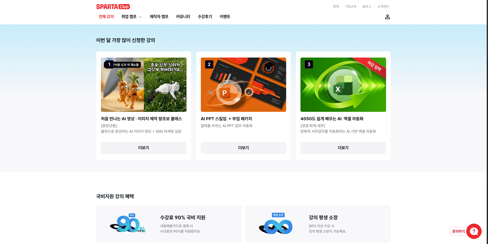

# HTML/CSS Clone Page

KANT AX Engineer 과정 CH2 프론트엔드 개발 평가 과제로 제작한 클론 페이지입니다.



## 프로젝트 소개

HTML과 CSS를 사용해 강의 목록 페이지를 구현했습니다. 시맨틱 태그를 활용해 헤더, 내비게이션, 본문 콘텐츠와 푸터 영역을 구분했습니다.

## 사용 기술

- HTML5
- CSS3
- JavaScript

## 실행 방법

저장소를 내려받은 뒤 `index.html`을 브라우저에서 열거나 다음 명령어로 로컬 서버를 실행합니다.

```sh
python3 -m http.server 8000
```

브라우저에서 <http://localhost:8000>에 접속합니다.

## 폴더 구조

```text
.
├── assets/
├── css/
│   └── style.css
├── js/
│   └── common.js
├── index.html
└── image.png
```

## 과제 제출 전 확인

- [x] 개인 Public 저장소로 분리
- [x] 전체 화면 캡처 포함
- [ ] 헤더·메인·푸터 부분 화면 캡처 추가
- [ ] GitHub Pages 배포 주소 추가

## 원본 작업 위치

이 저장소는 팀 클론 코딩 저장소에서 이명지가 담당한 페이지를 개인 과제 제출용으로 분리한 저장소입니다.

- [팀 저장소의 원본 작업 폴더](https://github.com/aiagentohms/mock_up_team3/tree/main/_2_%EC%9D%B4%EB%AA%85%EC%A7%80_%EC%A0%84%EC%B2%B4%EA%B0%95%EC%9D%98/mock-page)

